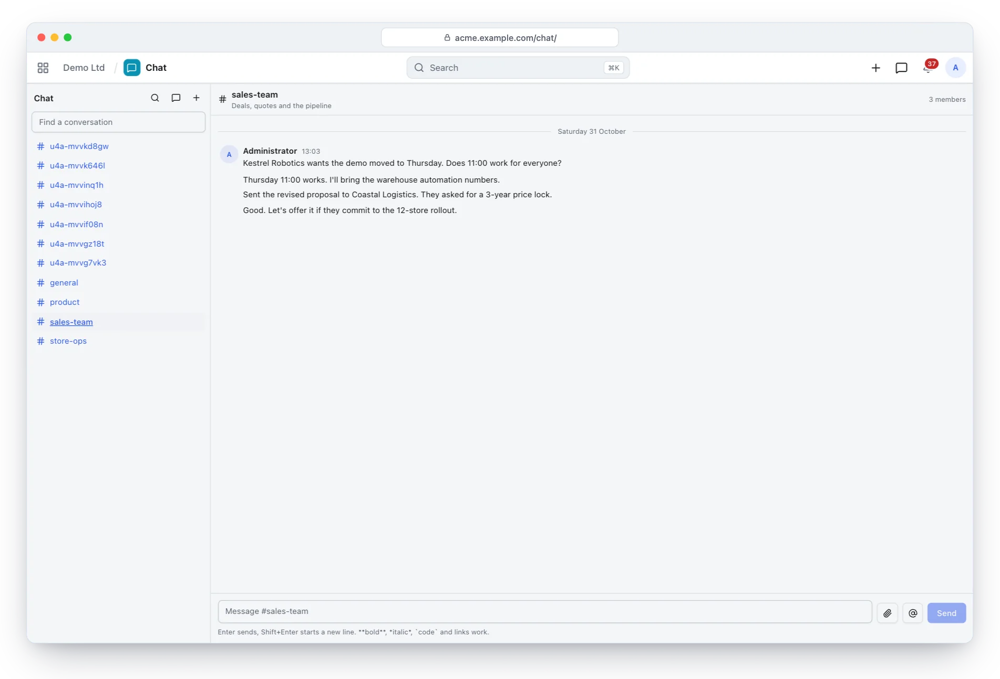
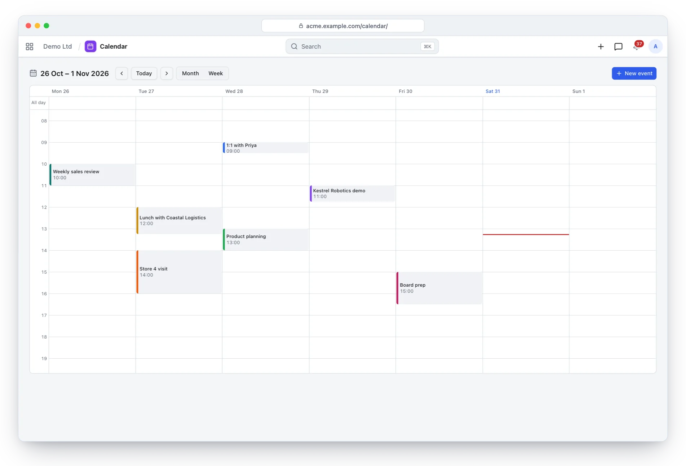
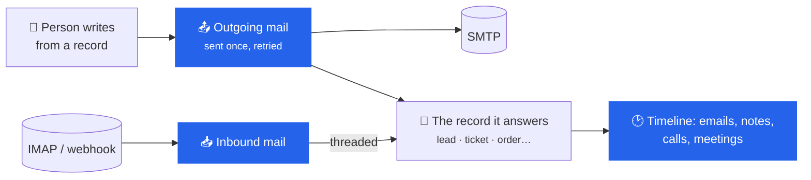
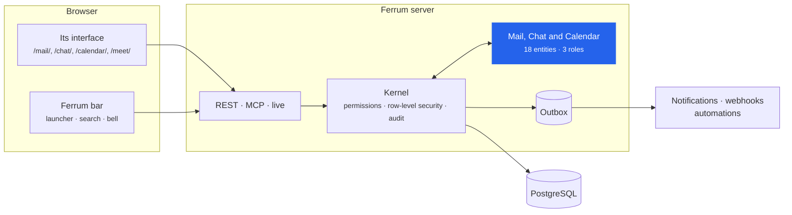
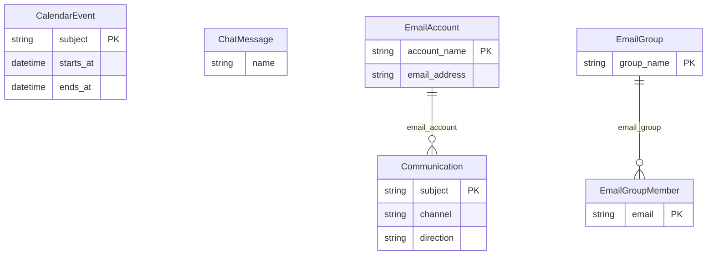

<div align="center">

<picture>
  <source media="(prefers-color-scheme: dark)" srcset="docs/assets/banner-dark.svg">
  
</picture>

[](https://github.com/CBFerrum/ferrum-app-comms/actions/workflows/ci.yml)      

**A native app for [Ferrum](https://github.com/CBFerrum/Ferrum), the open-source, AI-first business platform.**

[Overview](#overview) · [Highlights](#highlights) · [Screenshots](#screenshots) · [How it works](#how-it-works) · [Data model](#data-model) · [Install](#install) · [Develop](#develop) · [Changelog](#changelog)

</div>

---

## Overview

Mail, Chat and Calendar (the `comms` app) gives a workspace its communications: email accounts
per company with outgoing mail sent once and inbound mail threaded onto the record it answers;
team chat with channels, threads and mentions pushed live; calendars with invitations, recurrence
and reminders that sync both ways with Apple Calendar, Thunderbird, DAVx⁵ or Outlook; and video
meetings on a LiveKit server the operator runs.


| At a glance | |
|---|---|
| 📦 Version | `0.7.5` |
| 🧱 Platform | Ferrum `>=0.3.2, <0.4` |
| 🔗 Requires | nothing else |
| 🖥️ Interface | its own, at `/mail/`, `/chat/`, `/calendar/`, `/meet/` |
| 🗃️ Records | 18 entities in 1 package |
| 👥 Roles | 3: Comms User, Comms Manager, Chat Admin |
| 📊 Reports | 3 |
| 🧪 Tests | 36 Rust tests, 4 interface test files |


## Highlights

<table>
<tr>
<td width="50%" valign="top">

### ✉️ Mail on any record
SMTP/IMAP accounts, threaded communications, templates and newsletters with one-click unsubscribe.

</td>
<td width="50%" valign="top">

### 💬 Team chat
Public, private and direct channels; threads, mentions, edits, read markers and search, pushed live.

</td>
</tr>
<tr>
<td width="50%" valign="top">

### 📅 Calendars
Attendees and RSVP, recurrence with exceptions, reminders, free/busy and ICS invitations.

</td>
<td width="50%" valign="top">

### 🔄 Syncs with your apps
CalDAV and CardDAV for Apple Calendar, Thunderbird, DAVx⁵ and Outlook.

</td>
</tr>
<tr>
<td width="50%" valign="top">

### 🎥 Video meetings
A call in any channel or event on your own LiveKit server; guests join by link.

</td>
<td width="50%" valign="top">

### 📮 Hosted mail
With a Stalwart server, a mailbox for every person, kept in step with their account.

</td>
</tr>
</table>

## Screenshots

<picture>
  <source media="(prefers-color-scheme: dark)" srcset="docs/assets/chat-dark.webp">
  
</picture>

<p align="center"><sub>Chat: channels, a conversation and mentions, pushed live.</sub></p>

<picture>
  <source media="(prefers-color-scheme: dark)" srcset="docs/assets/calendar-dark.webp">
  
</picture>

<p align="center"><sub>Calendar: the week's meetings, colour-coded.</sub></p>

> [!TIP]
> The screenshots follow your GitHub theme: switch between light and dark to see both.

## How it works

### Mail on records



### Inside Ferrum



Everything Mail, Chat and Calendar adds is ordinary Ferrum metadata and Rust: its records get lists, forms,
search, permissions, an audit trail, exports and the REST and MCP APIs for free, so AI agents work
with them under the same rules as people.

### What it adds to Ferrum

| Where | What |
|---|---|
| 🚀 Launcher | **Mail** at `/mail/` |
| 🚀 Launcher | **Chat** at `/chat/` |
| 🚀 Launcher | **Calendar** at `/calendar/` |
| 🚀 Launcher | **Meet** at `/meet/` |
| ➕ Create menu | Email |
| 🔀 Intent | `compose` email |
| 🔀 Intent | `schedule` event |
| 🔀 Intent | `share` record |
| 🗔 Side panel | Chat |
| 🔎 Search | results from `chat` |
| 🔔 Notification | Calendar invitations and changes to them |
| 🔔 Notification | Answers to your invitations |
| 🔔 Notification | Event reminders |
| 🔔 Notification | Someone mentions you in Chat |
| 🔔 Notification | Replies to email you sent |
| 🔔 Notification | Email you sent that could not be delivered |
| ✅ My work | Invitations |
| 🌐 Public page | Meeting |

## Data model

The main records and how they connect (18 entities in all; `packages/` has every field).



### Roles

| Role | What it is for | Entities |
|---|---|---|
| **Comms User** | Sends mail from the records they can read, chats with colleagues and keeps a calendar. | 5 |
| **Comms Manager** | Email accounts and their credentials, templates, mailing lists, newsletters and every communication. | 10 |
| **Chat Admin** | Moderates team chat through the generic API (every channel and message, private ones included). | 2 |

<details>
<summary><b>Reports (3)</b></summary>

- Email Activity
- Newsletter Performance
- Chat Activity

</details>

## Install

Workspace administrators install it from **Apps** (`/store/`) in Ferrum; it ships in the
official Ferrum server image. Self-hosters building their own image enable the
`comms` feature of the server. Everything it adds is also available to AI agents over
Ferrum's MCP server, within each person's permissions.

## Develop

Clone it next to the platform:

```text
work/
├── ferrum/            https://github.com/CBFerrum/Ferrum (with Ferrum-Frontend cloned into ferrum/web)
└── ferrum-app-comms/
```

Point the platform dependencies at your checkout (this file is git-ignored):

```toml
# .cargo/config.toml
[patch."https://github.com/CBFerrum/Ferrum"]
ferrum-apps = { path = "../ferrum/crates/apps" }
ferrum-domain = { path = "../ferrum/crates/domain" }
ferrum-kernel = { path = "../ferrum/crates/kernel" }
ferrum-meta = { path = "../ferrum/crates/meta" }
```

The tests need PostgreSQL with an ordinary (non-superuser) role, so row-level security
applies:

```bash
createuser ferrum --pwprompt && createdb -O ferrum ferrum_comms_test
cargo test
```

`FERRUM_COMMS_TEST_DATABASE_URL` overrides the database URL.


The interface lives in `ui/` and builds with Ferrum-Frontend's packages:

```bash
cd ui
npm run build      # ui/dist, checked against the size budget
npm test
```

With a development server started with `FERRUM_DEV_UI=1`, `ferrum-app dev --ui` serves the pages
from Vite behind the real bar and session, with hot reload.


### Project layout

```text
app.yaml      the manifest: id, version, requirements, what it adds to Ferrum
packages/     metadata: entities, roles, reports, workflows, print formats
src/          the app's logic in Rust: hooks, actions, endpoints, upkeep jobs
ui/           its own interface (React + Vite), built into ui/dist
tests/        integration tests against a real PostgreSQL
CHANGELOG.md  what changed in each version
```

## Changelog

| Version | Highlights |
|---|---|
| **0.7.4** | The bar's search finds chat messages (`shell.search`): those in public channels and in the person's own, each opening its conversation. `GET … |
| **0.7.3** | Pop out in a browser that says it floats videos but cannot float a call's (a camera stream): the person is told so in plain words and the button … |
| **0.7.2** | Calls pop out: in a meeting, Pop out puts the call in a small window that stays above every other (Document Picture-in-Picture: a shared screen … |
| **0.7.1** | Depends on the platform's `contacts`: every workspace with Comms has the shared contacts and addresses, without CRM. Comms users read them, so … |

Every version is in [CHANGELOG.md](CHANGELOG.md).

## License

[AGPL-3.0-only](LICENSE), like the platform. Part of [Ferrum](https://github.com/CBFerrum/Ferrum) ·
[Report an issue](https://github.com/CBFerrum/ferrum-app-comms/issues)
